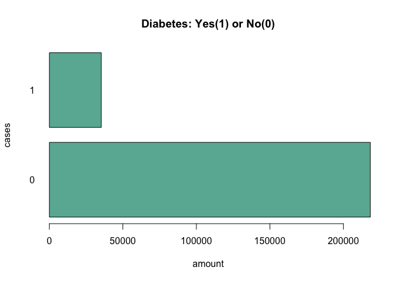

diabetes
================
Tsithembile Tembo
2026-11-02

Question: Predict whether a patient has diabetes(1) or no diabetes(0)

1.  loading data and looking at dataset get

``` r
#loading data and looking at dataset get
diabetes <- read.csv("/Users/thembie/Desktop/diabetes.csv")
head(diabetes)
```

    ##   Diabetes_binary HighBP HighChol CholCheck BMI Smoker Stroke
    ## 1               0      1        1         1  40      1      0
    ## 2               0      0        0         0  25      1      0
    ## 3               0      1        1         1  28      0      0
    ## 4               0      1        0         1  27      0      0
    ## 5               0      1        1         1  24      0      0
    ## 6               0      1        1         1  25      1      0
    ##   HeartDiseaseorAttack PhysActivity Fruits Veggies HvyAlcoholConsump
    ## 1                    0            0      0       1                 0
    ## 2                    0            1      0       0                 0
    ## 3                    0            0      1       0                 0
    ## 4                    0            1      1       1                 0
    ## 5                    0            1      1       1                 0
    ## 6                    0            1      1       1                 0
    ##   AnyHealthcare NoDocbcCost GenHlth MentHlth PhysHlth DiffWalk Sex Age
    ## 1             1           0       5       18       15        1   0   9
    ## 2             0           1       3        0        0        0   0   7
    ## 3             1           1       5       30       30        1   0   9
    ## 4             1           0       2        0        0        0   0  11
    ## 5             1           0       2        3        0        0   0  11
    ## 6             1           0       2        0        2        0   1  10
    ##   Education Income
    ## 1         4      3
    ## 2         6      1
    ## 3         4      8
    ## 4         3      6
    ## 5         5      4
    ## 6         6      8

``` r
str(diabetes)
```

    ## 'data.frame':    253680 obs. of  22 variables:
    ##  $ Diabetes_binary     : num  0 0 0 0 0 0 0 0 1 0 ...
    ##  $ HighBP              : num  1 0 1 1 1 1 1 1 1 0 ...
    ##  $ HighChol            : num  1 0 1 0 1 1 0 1 1 0 ...
    ##  $ CholCheck           : num  1 0 1 1 1 1 1 1 1 1 ...
    ##  $ BMI                 : num  40 25 28 27 24 25 30 25 30 24 ...
    ##  $ Smoker              : num  1 1 0 0 0 1 1 1 1 0 ...
    ##  $ Stroke              : num  0 0 0 0 0 0 0 0 0 0 ...
    ##  $ HeartDiseaseorAttack: num  0 0 0 0 0 0 0 0 1 0 ...
    ##  $ PhysActivity        : num  0 1 0 1 1 1 0 1 0 0 ...
    ##  $ Fruits              : num  0 0 1 1 1 1 0 0 1 0 ...
    ##  $ Veggies             : num  1 0 0 1 1 1 0 1 1 1 ...
    ##  $ HvyAlcoholConsump   : num  0 0 0 0 0 0 0 0 0 0 ...
    ##  $ AnyHealthcare       : num  1 0 1 1 1 1 1 1 1 1 ...
    ##  $ NoDocbcCost         : num  0 1 1 0 0 0 0 0 0 0 ...
    ##  $ GenHlth             : num  5 3 5 2 2 2 3 3 5 2 ...
    ##  $ MentHlth            : num  18 0 30 0 3 0 0 0 30 0 ...
    ##  $ PhysHlth            : num  15 0 30 0 0 2 14 0 30 0 ...
    ##  $ DiffWalk            : num  1 0 1 0 0 0 0 1 1 0 ...
    ##  $ Sex                 : num  0 0 0 0 0 1 0 0 0 1 ...
    ##  $ Age                 : num  9 7 9 11 11 10 9 11 9 8 ...
    ##  $ Education           : num  4 6 4 3 5 6 6 4 5 4 ...
    ##  $ Income              : num  3 1 8 6 4 8 7 4 1 3 ...

``` r
dim(diabetes)
```

    ## [1] 253680     22

2.  clean data

``` r
#number of duplicates 
#there is no need for duplicates with patients; dont want to have unecessary data 
sum(is.na(diabetes))
```

    ## [1] 0

3.  which features are the most significant (INFERENCE)

``` r
#fit all data 
all.fit <- glm(Diabetes_binary ~ ., data = diabetes, family = binomial)
summary(all.fit)
```

    ## 
    ## Call:
    ## glm(formula = Diabetes_binary ~ ., family = binomial, data = diabetes)
    ## 
    ## Coefficients:
    ##                        Estimate Std. Error z value Pr(>|z|)    
    ## (Intercept)          -7.8362269  0.0935514 -83.764  < 2e-16 ***
    ## HighBP                0.7575653  0.0147580  51.332  < 2e-16 ***
    ## HighChol              0.5785157  0.0135939  42.557  < 2e-16 ***
    ## CholCheck             1.2439989  0.0685766  18.140  < 2e-16 ***
    ## BMI                   0.0608673  0.0009004  67.599  < 2e-16 ***
    ## Smoker               -0.0103902  0.0132025  -0.787 0.431291    
    ## Stroke                0.1341797  0.0251011   5.346 9.01e-08 ***
    ## HeartDiseaseorAttack  0.2204224  0.0178010  12.383  < 2e-16 ***
    ## PhysActivity         -0.0518051  0.0144453  -3.586 0.000335 ***
    ## Fruits               -0.0499323  0.0136914  -3.647 0.000265 ***
    ## Veggies              -0.0331513  0.0159143  -2.083 0.037241 *  
    ## HvyAlcoholConsump    -0.7691728  0.0385303 -19.963  < 2e-16 ***
    ## AnyHealthcare         0.0826594  0.0334658   2.470 0.013512 *  
    ## NoDocbcCost           0.0179572  0.0230278   0.780 0.435505    
    ## GenHlth               0.5359461  0.0081373  65.863  < 2e-16 ***
    ## MentHlth             -0.0036317  0.0008539  -4.253 2.11e-05 ***
    ## PhysHlth             -0.0074067  0.0007834  -9.454  < 2e-16 ***
    ## DiffWalk              0.1231906  0.0169792   7.255 4.01e-13 ***
    ## Sex                   0.2581335  0.0134574  19.182  < 2e-16 ***
    ## Age                   0.1236446  0.0027974  44.200  < 2e-16 ***
    ## Education            -0.0308251  0.0069707  -4.422 9.77e-06 ***
    ## Income               -0.0514863  0.0035699 -14.423  < 2e-16 ***
    ## ---
    ## Signif. codes:  0 '***' 0.001 '**' 0.01 '*' 0.05 '.' 0.1 ' ' 1
    ## 
    ## (Dispersion parameter for binomial family taken to be 1)
    ## 
    ##     Null deviance: 204847  on 253679  degrees of freedom
    ## Residual deviance: 162184  on 253658  degrees of freedom
    ## AIC: 162228
    ## 
    ## Number of Fisher Scoring iterations: 6

- based on signif. codes NoDocbcCost and Smoker are not significant

``` r
#remove NoDocbcCost and Smoker 
diabetes$Smoker <- NULL
diabetes$NoDocbcCost <- NULL
colnames(diabetes)
```

    ##  [1] "Diabetes_binary"      "HighBP"               "HighChol"            
    ##  [4] "CholCheck"            "BMI"                  "Stroke"              
    ##  [7] "HeartDiseaseorAttack" "PhysActivity"         "Fruits"              
    ## [10] "Veggies"              "HvyAlcoholConsump"    "AnyHealthcare"       
    ## [13] "GenHlth"              "MentHlth"             "PhysHlth"            
    ## [16] "DiffWalk"             "Sex"                  "Age"                 
    ## [19] "Education"            "Income"

4.  logistic regression (PREDICTIVE)

``` r
#split training and testing data, 50 percent
set.seed(13)
train <- sample(1:nrow(diabetes), nrow(diabetes) * 0.5)
train.data <- diabetes[train, ]
test.data <- diabetes[-train, ]

glm.fit <- glm(Diabetes_binary ~ ., data = train.data, family = binomial)
summary(glm.fit)
```

    ## 
    ## Call:
    ## glm(formula = Diabetes_binary ~ ., family = binomial, data = train.data)
    ## 
    ## Coefficients:
    ##                       Estimate Std. Error z value Pr(>|z|)    
    ## (Intercept)          -7.792701   0.129629 -60.115  < 2e-16 ***
    ## HighBP                0.735474   0.020838  35.295  < 2e-16 ***
    ## HighChol              0.592327   0.019211  30.832  < 2e-16 ***
    ## CholCheck             1.189016   0.096219  12.357  < 2e-16 ***
    ## BMI                   0.060960   0.001277  47.749  < 2e-16 ***
    ## Stroke                0.094633   0.036035   2.626 0.008637 ** 
    ## HeartDiseaseorAttack  0.220225   0.025031   8.798  < 2e-16 ***
    ## PhysActivity         -0.034101   0.020495  -1.664 0.096141 .  
    ## Fruits               -0.042967   0.019382  -2.217 0.026631 *  
    ## Veggies              -0.030883   0.022573  -1.368 0.171264    
    ## HvyAlcoholConsump    -0.776192   0.054534 -14.233  < 2e-16 ***
    ## AnyHealthcare         0.046781   0.045953   1.018 0.308669    
    ## GenHlth               0.539296   0.011476  46.994  < 2e-16 ***
    ## MentHlth             -0.004395   0.001204  -3.652 0.000261 ***
    ## PhysHlth             -0.004863   0.001101  -4.417 1.00e-05 ***
    ## DiffWalk              0.102414   0.024046   4.259 2.05e-05 ***
    ## Sex                   0.278508   0.018860  14.767  < 2e-16 ***
    ## Age                   0.125131   0.003918  31.940  < 2e-16 ***
    ## Education            -0.039672   0.009835  -4.034 5.49e-05 ***
    ## Income               -0.046106   0.005031  -9.164  < 2e-16 ***
    ## ---
    ## Signif. codes:  0 '***' 0.001 '**' 0.01 '*' 0.05 '.' 0.1 ' ' 1
    ## 
    ## (Dispersion parameter for binomial family taken to be 1)
    ## 
    ##     Null deviance: 102292  on 126839  degrees of freedom
    ## Residual deviance:  80989  on 126820  degrees of freedom
    ## AIC: 81029
    ## 
    ## Number of Fisher Scoring iterations: 6

``` r
# predict on testing data 
glm.probs <- predict(glm.fit, test.data, type = "response")
glm.pred <- rep(0, nrow(test.data))
glm.pred[glm.probs > .5] <- 1
```

5.  Evaluate Model

``` r
mean(glm.pred != test.data$Diabetes_binary)
```

    ## [1] 0.1369836

``` r
table(Predicted = glm.pred, Actual = test.data$Diabetes_binary)
```

    ##          Actual
    ## Predicted      0      1
    ##         0 106751  14995
    ##         1   2380   2714

TN: 106,750 TP: 2,381 FN: 14,993 FP: 2,716

Inbalances in the number of cases for postive and negative. It matters
more to get TP than TN, due to wanting to find out more wether soemone
has diabetes than if they do not.

``` r
# plot the number of 0 and the and the numebr of ones 

#count 1's and 0's 
counts <- table(diabetes$Diabetes_binary)

barplot(height=counts, 
        col="#69b3a2",
        xlab="amount",
        ylab="cases",
        main="Diabetes: Yes(1) or No(0)",
        horiz=T, las=1)
```

<!-- -->

Even if we split the training data in half, the training data is trained
on more negative cases than the positive cases.In this case the model is
more trained for idenitfying 0’s than 1’s. What matters more diagnosing
a positive or negative case of diabetes? Diagnosing a Positive Case!
